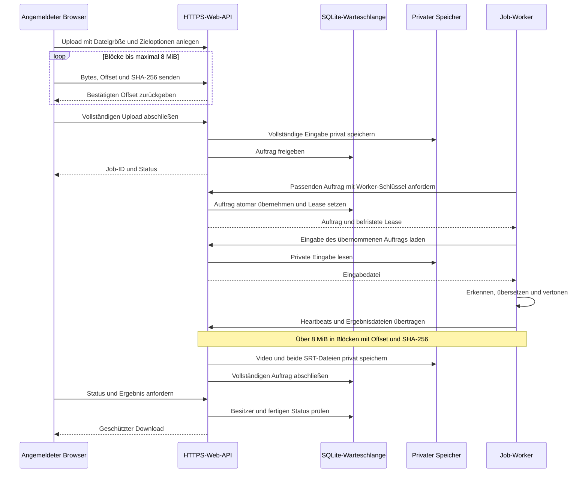

# Webdienst und Remote-Worker

Stand: 14. Oktober 2026. Der Upload-Dienst ist implementiert und unter
[Webversion öffnen](https://stayinleipzig.de/linguoai/web.html) eingerichtet.
Nutzer melden sich an, laden ein Video hoch und erhalten das übersetzte Video
sowie Original- und übersetzte SRT-Untertitel als geschützte Downloads.

## Eingerichteter Betrieb

Auf Debian 13 läuft die API ausschließlich unter `127.0.0.1:8765`.
Nginx vermittelt den öffentlichen HTTPS-Pfad `/linguoai/`. Die Dienste
`linguoai-web.service` und `linguoai-worker.service` sind eingerichtet und aktiviert.
Ein CPU-Worker verarbeitet jeweils einen Auftrag. Weitere Rechner können als
Job-Worker über HTTPS Aufträge übernehmen, ohne eine eigene Browseroberfläche zu starten.

Für `studio.linguoai.de` ist ein HTTP-Origin hinter dem orangefarbenen
Cloudflare-Proxy vorbereitet. Die vorhandenen Cloudflare-SSL-Einstellungen bleiben
bestehen; für diesen Weg ist kein Origin-Zertifikat erforderlich. Die öffentliche
Migration ist noch nicht bestätigt. Die konkrete Proxyvorlage und die Prüfung
vor einem Adresswechsel stehen in [Domainmigration](../deploy/DOMAIN_MIGRATION.md).

Der echte Server-Test bestätigt Parakeet-Erkennung mit deutschem Audio:
2,752 Sekunden Audio wurden in 2,104 Sekunden Decoderzeit erkannt (RTF 0,765),
zuzüglich 4,739 Sekunden Modellstart; der Prozess belegte dabei etwa 835 MB RSS.
Das ist eine Einzelmessung. Die anschließende öffentliche Google-Übersetzung
antwortete mit HTTP 429 („Too Many Requests“). Ein vollständig übersetztes echtes
Video mit Downloads ist deshalb noch nicht bestätigt. Der Übersetzungszugang wird
auf Wunsch später eingerichtet. DeepL/Gemini werden nach privater Worker-Konfiguration
und Installation ihrer jeweiligen Abhängigkeiten verfügbar.

Automatisierte API-/Worker-Integrationstests verwenden eine simulierte Pipeline
und prüfen Auftragsablauf, Besitzerschutz, Abbruch und Ergebnisübertragung.
Der reale Anbieter-Test prüft zusätzlich die externe Übersetzung und zeigte die
oben genannte Google-Ratenbegrenzung.

Neue Dateien liegen seit dem 15. Oktober 2026 im **privaten Google-Drive-Ordner
„linguoai uploads“** des Betreibers. SQLite unter `/var/lib/linguoai-web` speichert
Warteschlange, Besitzer, Optionen, Fortschritt und Ablaufdaten. Lokaler Zwischenspeicher
wird weiterhin für Übertragung und Verarbeitung benötigt; vorhandene lokale
Dateireferenzen bleiben nach dem Speicherwechsel erreichbar.

Der Browser braucht Datei, Zielsprache, Start und Download. Erweiterte Optionen
enthalten Erkennung, Quellsprache und Stimme. Die verfügbaren Möglichkeiten richten
sich nach den gemeldeten Worker-Fähigkeiten. Parakeet benötigt eine ausdrücklich
gewählte unterstützte Quellsprache; Whisper kann die Quellsprache erkennen.

## Übertragung, Wiederaufnahme und Abbruch

Der Browser verwendet das implementierte Protokoll `chunks-v1`: Upload anlegen,
maximal 8 MiB Rohdaten je Block senden und den vollständigen Upload abschließen.
Jeder Block hat einen Offset und eine SHA-256-Prüfsumme. Die API speichert
bestätigte Offsets und private Zwischendateien dauerhaft. Verlorene Antworten
führen bei einer Wiederholung nicht zu doppelten Blöcken oder Aufträgen.

Die geöffnete Oberfläche zeigt Fortschritt anhand der übertragenen Bytes und
wiederholt vorübergehende Verbindungsfehler begrenzt am bestätigten Stand.
Ein neuer Browserstart kann die zuvor ausgewählte lokale Datei nicht automatisch
lesen. Ein API-Neustart erhält dagegen den Uploadstand und setzt bereits
angeforderte Abschlüsse im Hintergrund fort. Erst nach vollständiger privater
Speicherung wird der Auftrag für einen Worker freigegeben.

Worker verwenden denselben Blocktransfer für Ergebnisse über 8 MiB; kleinere
Ergebnisse werden weiterhin per Multipart gesendet. Heartbeats laufen während
der Übertragung weiter. Ein Abbruch oder eine veraltete Lease beendet die
Übertragung und verhindert die Veröffentlichung. Abgebrochene oder abgelaufene
Zwischendateien werden bereinigt. Eingaben und Ergebnisse bleiben an Besitzer
beziehungsweise Job-Lease gebunden; eine bekannte Upload-ID gewährt keinen Zugriff.

Die Oberfläche bietet Uploadabbruch und Auftragsabbruch an. Video und beide
Untertitel werden erst nach vollständigem Abschluss gemeinsam als geschützte
Downloads angeboten; sie sind kein öffentliches Drive-Link-Sharing.

## Warteschlange und Betriebsgrenzen

Die API bietet Login/Logout, eigene Aufträge, Status, Abbruch und Ergebnisdownloads.
Alle API-Pfade liegen öffentlich unter `/linguoai/api/...`. Job-Zustände sind
`uploading → queued → running → completed`, außerdem `failed`, `cancelled` und `expired`. Öffentliche Zeitstempel sind Unix-Sekunden; `finished_at` zeigt den
Abschluss und `available_at` wird nur bei vollständig fertigen Ergebnissen gesetzt.

Aufträge werden atomar übernommen und besitzen einen zufälligen Lease-Schlüssel.
Heartbeats verlängern die 90-Sekunden-Lease. Nach einem Worker-Ausfall ist eine
begrenzte Wiederaufnahme möglich; ein alter Worker kann seine Ergebnisse danach
nicht mehr veröffentlichen. Ein Auftrag gilt erst mit Video und beiden Untertiteln
als abgeschlossen. Ein angeforderter Abbruch kann nicht nachträglich als Erfolg enden.
Unvollständige und nicht angehängte Uploads werden für wiederholbare Bereinigung erfasst.

| Einstellung | Aktueller Wert |
| --- | --- |
| Eingabe je Datei | 100 MiB |
| Ergebnis je Datei | 1 GiB |
| Aktive Aufträge je Benutzer / insgesamt | 2 / 20 |
| Aufbewahrung | 24 Stunden nach Abschluss |
| Worker-Lease | 90 Sekunden |
| Lokale Verarbeitung | Ein Auftrag gleichzeitig |
| CPU-Anteil API / Worker | 50 % / 150 % |
| Arbeitsspeicher-Obergrenze API / Worker | 512 MiB / 2 GiB |

Diese Größen sind Grenzen, keine zugesicherte Kapazität für 20 gleichzeitig
laufende Videos. Temporäre Dateien, Modelle und Ergebnisse benötigen lokalen Speicher.
Die API begrenzt Browser-Eingaben weiterhin auf 100 MiB und authentifizierte
Worker-Ergebnisse auf 1 GiB je Datei. Die 8-MiB-Blockgrenze gilt zusätzlich je
Request und vergrößert diese Dateigrenzen nicht. Die Studio-Proxyvorlage begrenzt
Block-Requests auf `8m`; die ältere `1025m`-Grenze bleibt nur für kompatible
Worker-Multipart-Uploads bestehen. Große Transfers durch den öffentlichen
Cloudflare-Proxy verwenden die kleinen Blöcke. Private API- und Downloadantworten
bleiben mit `Cache-Control: no-store` von Zwischenspeicherung ausgeschlossen.

## Erkennung auf dem CPU-Worker

Das installierte NVIDIA-Parakeet-v3-Profil liegt unter
`/var/lib/linguoai-web/models/parakeet-v3` und nutzt `sherpa-onnx` mit vier CPU-Threads.
Die Verarbeitung verwendet Audioabschnitte von 30 Sekunden und Arbeitsdateien unter
`/var/lib/linguoai-web/work`. Der Worker meldet nur tatsächlich installierte Modelle
und Anbieter. Das mehrsprachige v3-Profil unterstützt die 25 veröffentlichten
Sprachen; das deutsche primeline-Profil kann separat ergänzt werden. Faster-Whisper
bleibt eine Alternative.

Parakeet übernimmt die Texterkennung. Übersetzung und Sprachausgabe folgen als
eigene Schritte. Die Geschwindigkeit und Textqualität sollten mit denselben
Aufnahmen und Zeitmarken auf der vorgesehenen Hardware verglichen werden;
die Integration allein ist keine Qualitäts- oder Geschwindigkeitsgarantie.

## Google Drive bleibt eine Betreiberanbindung

Eingerichtet ist **ein privater Ordner des Betreibers**, den nur die Server-API nutzt.
Ordner und OAuth-Freigabe wurden angelegt und serverseitig geprüft. Nutzer benötigen kein
eigenes Google-Konto; Drive erscheint nicht als zusätzliche Anmeldung oder Freigabe
im Nutzerablauf. Dateien gelangen über dieselbe API hinein und wieder als Download zurück.

Für ein persönliches Betreiber-Drive wird ein echter OAuth-Zugang mit
`authorized_user`-Zugangsdaten und dem Scope `drive.file` benötigt. Alternativ ist
mit `service_account`-Zugangsdaten ein echter Workspace Shared Drive möglich.
Ein bloß für einen Service Account freigegebener MyDrive-Ordner ersetzt den Shared
Drive nicht. Der Ordner darf nicht öffentlich freigegeben werden.

Nach Einrichtung setzt der Betreiber `storage_backend`, `drive_folder_id`,
`drive_credentials_path` und gegebenenfalls `drive_shared` in der privaten
Serverkonfiguration. Zugangsdaten bleiben in der geschützten Betreiberablage und auf dem Server.
Speicherquoten, Übertragungsgrenzen und Anbieterbedingungen gelten weiterhin.
Ein kleiner Testauftrag mit anschließendem Download und Löschung bestätigt erst
den tatsächlichen Drive-Betrieb. Der serverseitige Upload-, Download- und Löschtest
war erfolgreich; die öffentliche API meldet das aktive Drive-Backend. Die Google-App
ist auf „In Produktion“ gestellt. Die danach erneuerte Betreiberfreigabe mit demselben
Scope `drive.file` wurde auf dem Server installiert und erneut geprüft; ihre feste
siebentägige Testing-Frist entfällt. Die Datennutzung beschreibt die
[Drive-Datenschutzseite](https://linguoai.de/drive-datenschutz.html).

## Installation und reine Job-Bots

[Deployment und Remote-Worker](../deploy/README.md) beschreibt systemd,
private Konfiguration, Modellinstallation und einen eigenständigen HTTPS-Worker.
Der Job-Bot benötigt einen separaten Worker-Schlüssel vom Betreiber, keine
Browser-Zugangsdaten und keine Drive-Zugangsdaten. Er fragt passende Aufträge ab,
lädt nur seine übernommenen Eingaben, meldet Heartbeats und sendet Ergebnisse zurück.
Die Colab-Oberfläche bleibt unabhängig davon als sitzungsgebundene Alternative verfügbar.

## Modell- und Speicherreferenzen

- [NVIDIA Parakeet v3](https://huggingface.co/nvidia/parakeet-tdt-0.6b-v3)
- [primeline-Modellkarte](https://huggingface.co/primeline/parakeet-primeline)
- [sherpa-onnx-Modelle](https://k2-fsa.github.io/sherpa/onnx/pretrained_models/offline-transducer/nemo-transducer-models.html)
- [Faster-Whisper](https://github.com/SYSTRAN/faster-whisper)
- [Drive-Uploads](https://developers.google.com/workspace/drive/api/guides/manage-uploads)
- [Drive-Zugriffsbereiche](https://developers.google.com/workspace/drive/api/guides/api-specific-auth)
